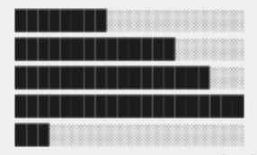
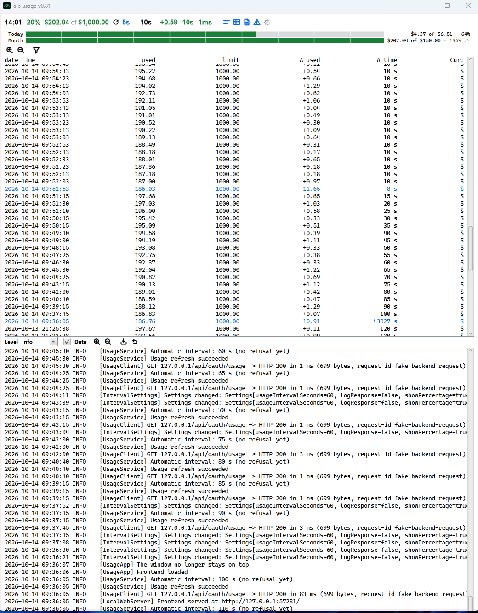
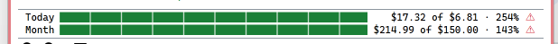

a funtionality to change the directory for log files and history files

it should be possible to configure if in the main row the limit received in a request or the
configure monthly should be shown.

in the history view the limit received from server and the configured monthly limit shall be
shown. also the daily limit should be shown and additional info, if the value of the
daily limit was automatic calculated or set by the user.

in the main row the used value and the percentage value will be red if the usage is higher
as the received or calculated limit.

in the cost control view, in daily usage, current usage is extrapolated, assume a workday of
8h (make if configurabel in cost convtroll settings) when extraploation is higher than
the daily limit make the barchart yellow, of course make it red, if already consumed more than
the daily limit.

similar extrapolation for monthly usage if th burn rate is higher than it should be to reach
the monthly goal, the diagram shall be yellow.

the number of working days is calculated the working days (mo-fr) of the current month. it
should be also possible to set it manually

add to the main row the daily usage and the limit, like for month, including percentage also
configurable. the lefthand side of the main row, there should be circle which is green when
both daily and monthly usage is below the limits and extrapolation to. when the extraploation
for one or both values get yellow, there circle is also yellow. if one of the two usages
got red, the circle is red filled. the circle should also be configurael show or hide.

the circle should have a tool tip, explaining the current status, why its yello or red.

 make the barcharts like the image. the dark gray is green, the light gray
could be a light green, but also with the changes, so not solid green but with some changes,
like dark gray, a smal bar light gray, the same for the light gray

the icons for zoom in/out, filter, etc the shall horizontal alligned on the right hand side.

error view is not visible 

 add to costcontroll view checkbox, show/hide $, default is hide. remove the warning sign,
make barchart red
