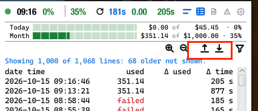
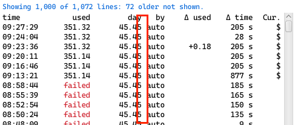
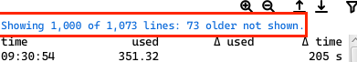
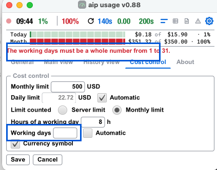
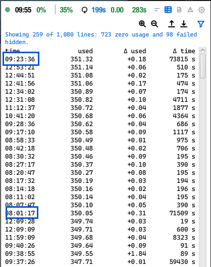
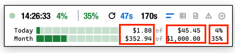

in log file the interval calculation shall be shown, clear indication that
value is automatic calculated.

when taskbar/dock clicked to show aip usage, make a visual effect to faster find it,
maybe make show a rectangle a the postion of the window, animated it let the rectangle
grow to and move it to slowly to the mid of the screen, than let it shrink again.

remove extend, shrink button in every view 

when the countdown reaches zero and a request is sent, the usage view is not updated.
when the request is triggered manualy, the history view is updated

there is to less space between 

 text is rather short, difficult to get what it is for, add a 
longer description

when a scrollbar is clicked and dragged, it should not move the entire window, but
just move the slider of the scrollbare.

add a toolbar explaining what is for 

when there is a wrong filled entry field or empty an set the focus to this field

when unchecking  Working days automatic, do not delete the value in the input field. do the same for the
automatic for daily limit

 when in the history view a row is the first of the day, mark it with a light
gray under line (underscore). if the view is collapse it should happen the same, but only using visible
data.

make configurable 