there should be a functionalitty which supports more than one view at the same time, it should be possible eg
to show cost control and history view at the same time. there should be a checkbox which  thsi behavior
can be turned on and off. default is off. if it is on, when pressing an icon to show a view, the icon gets blue
as usual. another view which is already open, stays open and the according icon stays with blue color. is an
icon with blue is pressed, the view is closed and the icon is no long blue.

start with general

in history view stronger font as it is heaere 
![img_16.png](img_16.png font is not bold enough

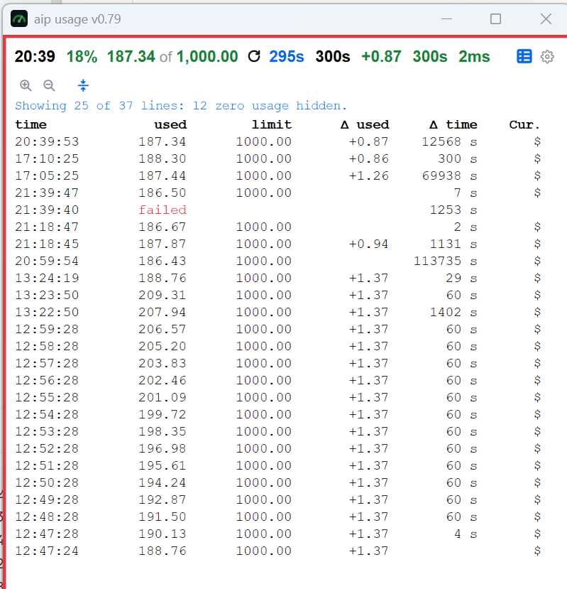 there are still lines without value shown

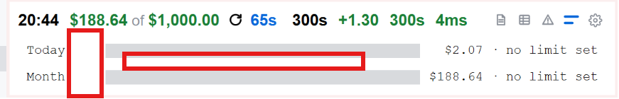 reduce space

 the placeholder instead of the green rectangel the green line only at the bottom, the thickness like
the blue of the selected tab in settings.   

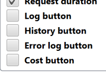 replace button by icon text

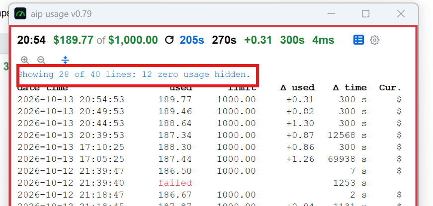 make this bold

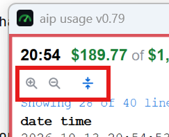 the icons are hard to see, make them more visible

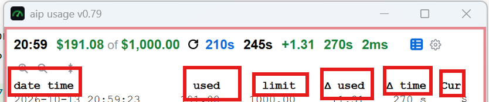 add tooltip

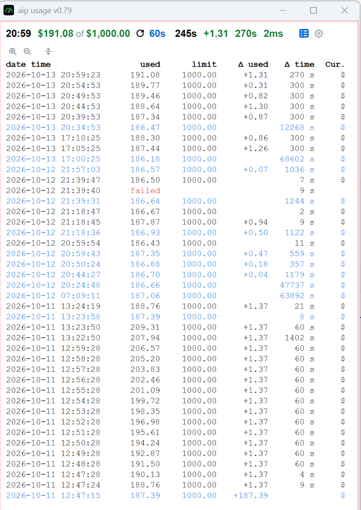 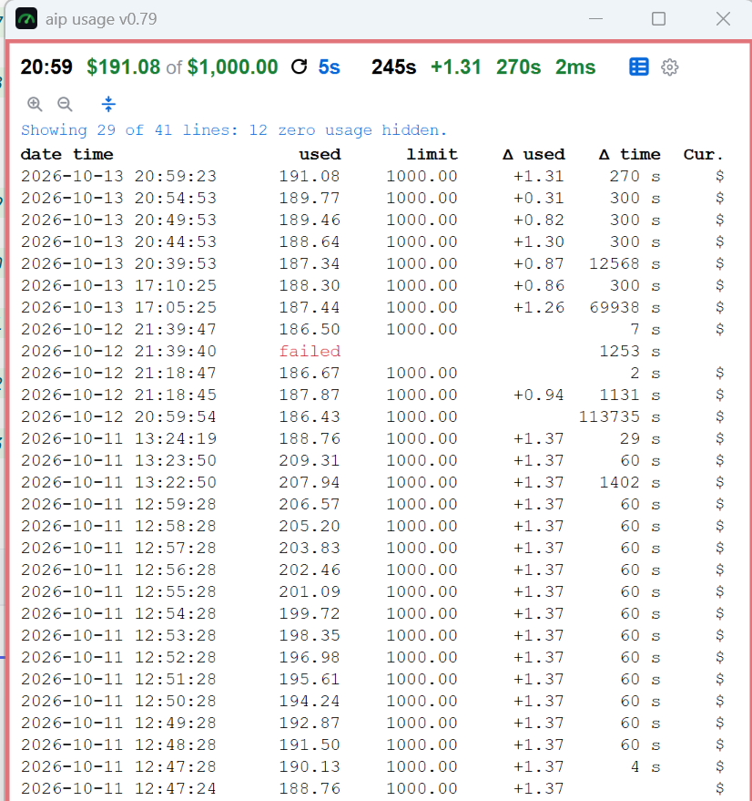 hide zero usage line does not work correctly

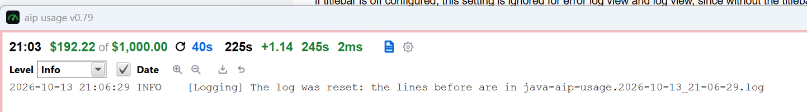 log also path make, make the file/path clickable, open finder/explorer

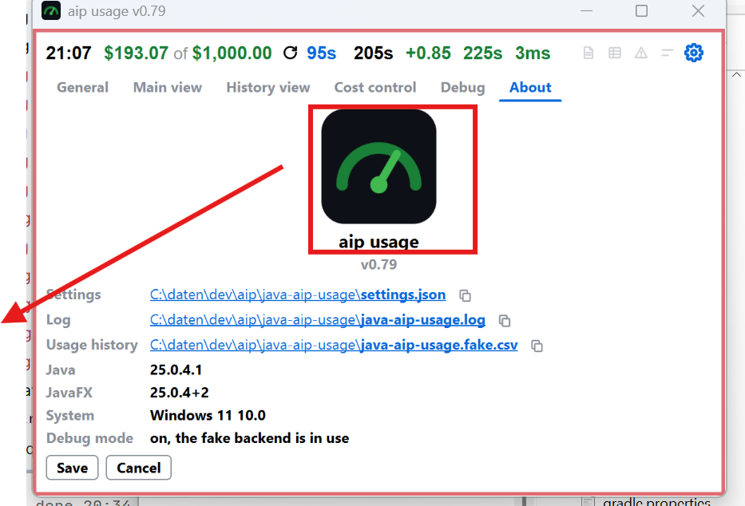 move the loggo to the lefthand side, the date/files etc shall be right of the logo

if an icon is slected to show eg history, costs, log, ... etc, selecting settings, than the icon which
curremtly is selected is in main view settings unchecked, when leaving the settings page, the view is not shown.

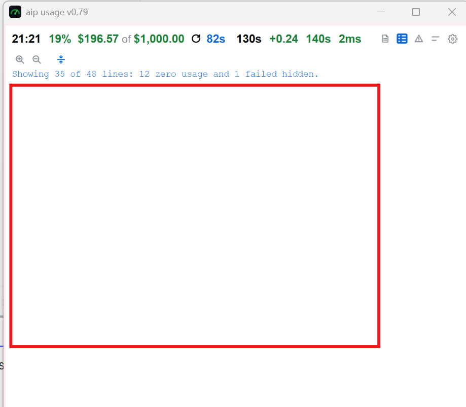 the lines are missing, they are not displayed