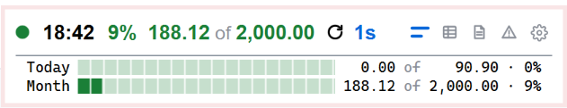
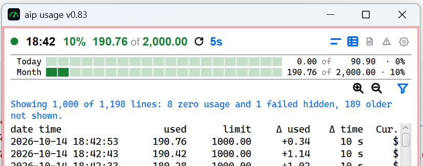
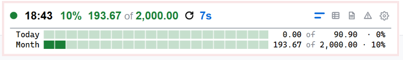
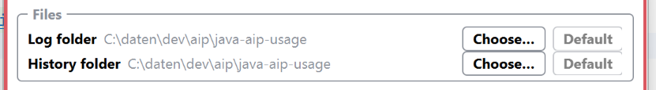
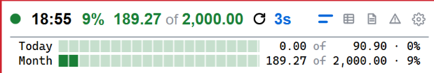
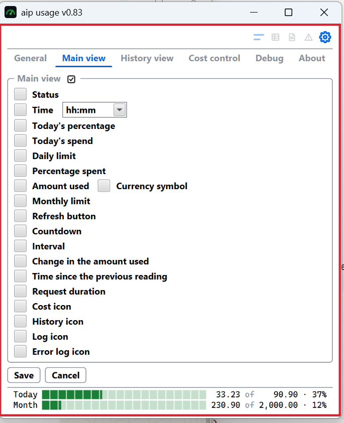
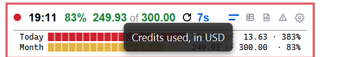
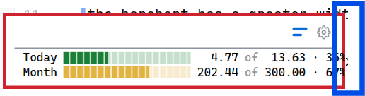

after opening the history view and closing it again, the window width is bigger than it was. i should have the same
witdh before showing the history view

same path for both files, only on selection

 calculate the size of the green rectangle. use this size also when
the barchart has a greater width.

when several views ad once is checked and history view is selected, history view is always the first one after
the main row.

 when settings view is closed, also cost control is closed, should stay

 i want this yellow

 monthly credit used

the monthly and the  daily usage should have the same color as the barcharts

 there is to less space