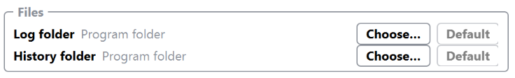

 same path for log and history folder, only one choose and default

when title bar is unchecked, the title bar should not be shown in any view or views. only exception config view
in this case it should be schown.