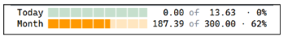
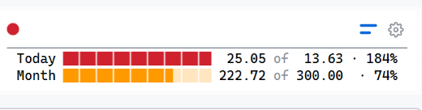

there should be more space at between chart and boarder

 main row disappears also the status is shown.

in main row for numbers the same orange should be used as for the indicator

separator if there is only one view there is no need for seperator line.

the cost control view will always beshown after the main row, no matter
which other views are shown inlcuding settings view