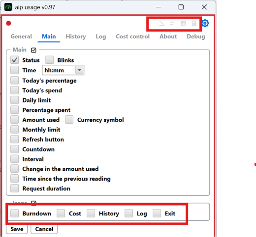
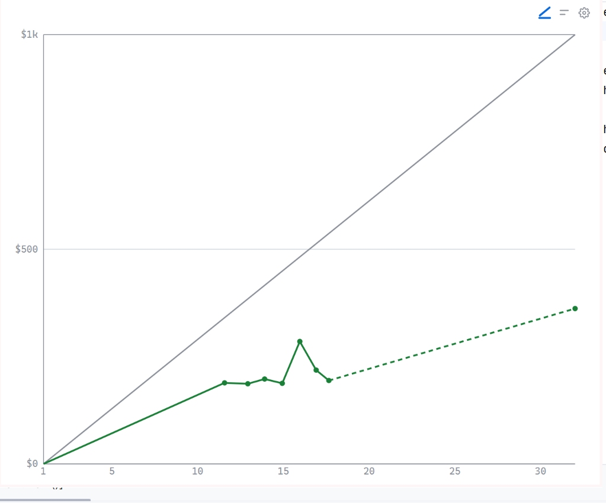
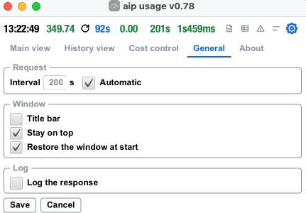
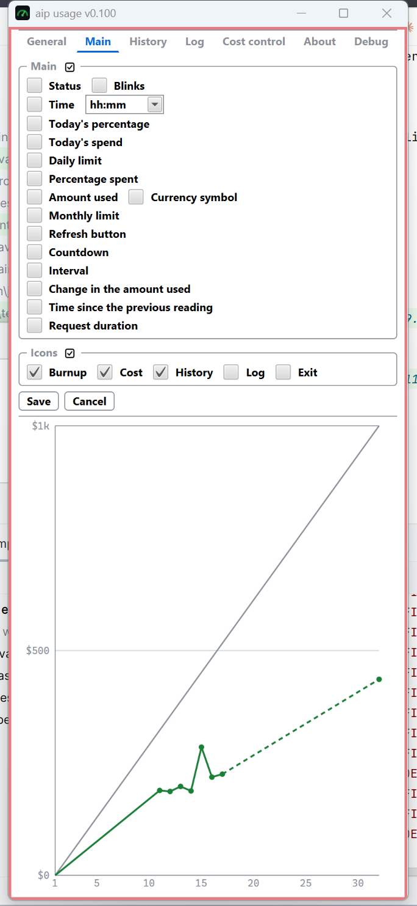
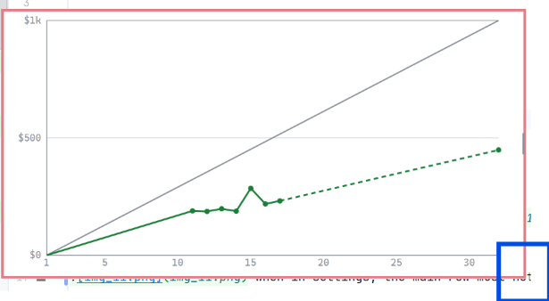
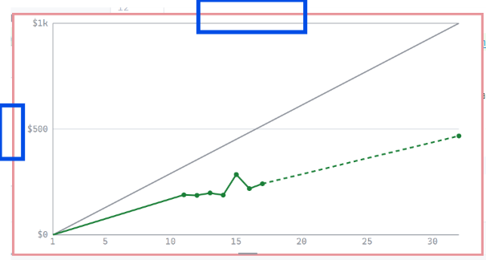

in settings view, all icon on the right hand side will shown, not matter
if the are turned off. if they are turned off, there shall be an indication that
they are turned off but shown to be able to click on it. also the tool
tip shall mentioned it that the button will disapear, when the settings view is closed.

in history view add feature to colaps lines with no changes, so there are no lines 
shown with empty delta time.

no horizontal scrollbar 

not java shown but aip-usage 

exit

why is there such a big gap 

general tab should be the first tab, about the last tab.

each control in the settings view in each tab should have a  meaningfull
tooltip with an explanation what it is for and if it makes sense also
the possible value range.

the barchart should not have rounded corner, instead of This month, only month.
the barcharts should have the same with

if titlebar is off configured, this setting is ignored for error log view and log view,
since without the titlebar it cannot be resized. or the otherway round in a view which
must be resizeable by the user, the title is shown if it is neccessary for resizing.

add a feature to reset the log file. add a button in log view if you press it
the current logfile will be renamed with date and time and empty one will be started.
add also a button to merge the current log file with the "newest" old log file.
this is a kinda undo. the old one is deleted.

automatic is on, but it do not reduce the interval. there are
no failed requests.

make about tab horizontal resizeable to make the ulrs easier readable. make the filename bold, only the filename.

like in main setting page, there should a possiblity to turn all
checkboxes with one click on and off.

no titlebar for costcontroll if disabled.

clicking log view icon and then settings icon the width stays the log view, in settings view
i must be way smaller 