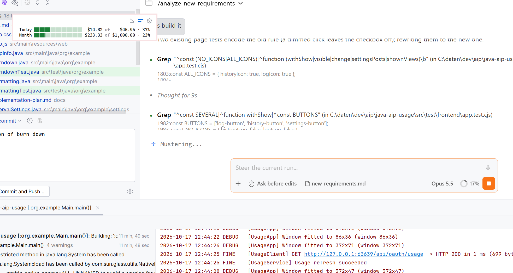
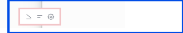

show claude code version

add ping functionality

add show the token

create token.

send a prompt

 when clicking the icon to hide cost control, 
the window jumps  down but the top left corner should not change.

 when starting with small size, the location indicator
is way bigger then the window, especially when the performance indicator height
is close to the height of the window.