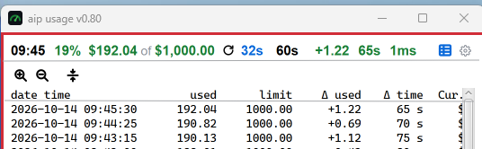
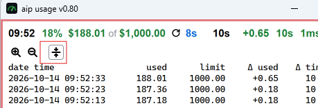
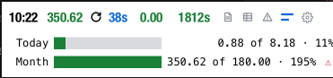
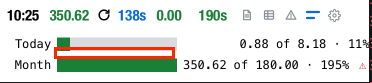
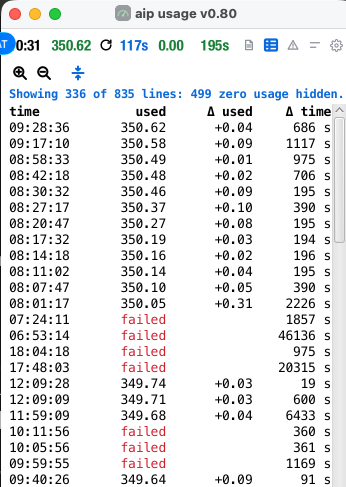
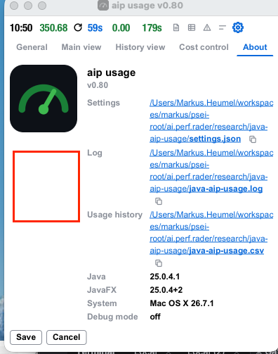
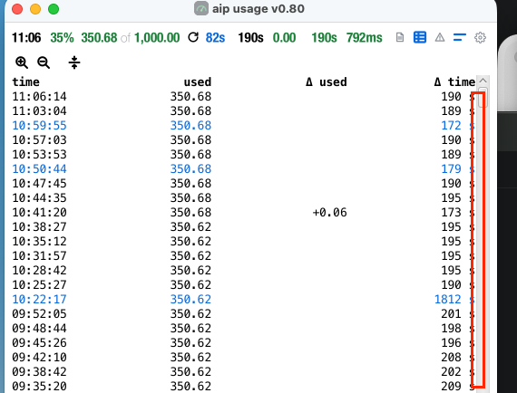

a funtionality to change the directory for log files and history files

order of icons, several views at once, where needed a separater between the views, a black solid line

 add gray lines/dark gray lines to seperate views.

 the icon does not make clear what it is about, choose a better visual
representation

when clicking collaps, this works, but when deselecting

do not use courier font, use the same: 

its still to much space, make font smaller if necessary; 

the bar chart shall be shown with blocks of 10%, between the 10 percents there is small visible
separater.

also hide failed requests 

vertical align center [

if several views is selected also the settings view can be open at the same time with other views.]()

there should be a bit more space between s and the scrollbar