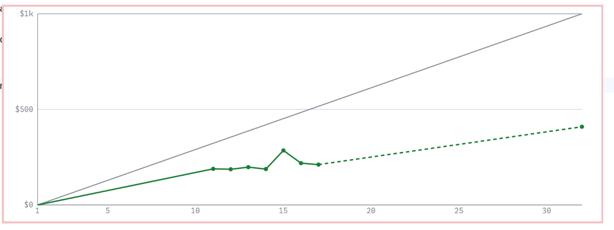
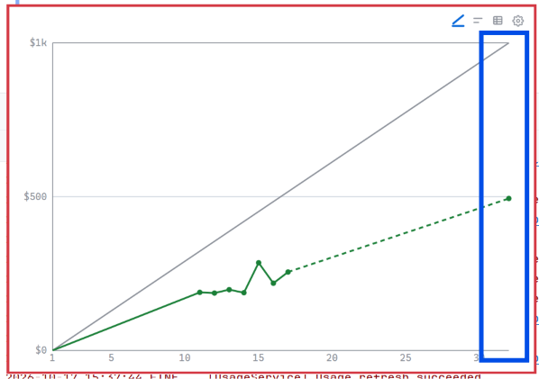

show claude code version

add ping functionality

add show the token

create token.

send a prompt

 when opening settings 

 when in settings, the main row must not hide when mouse left the window 

 here should be a handle to resize width and heigt together, this should be for 
all resizeable views

 here should be a line write the used value of the green line a the end of the mounth,
do the same thing in red, if overusage.
