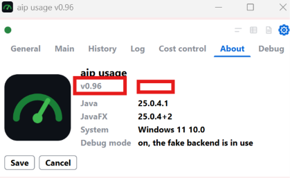
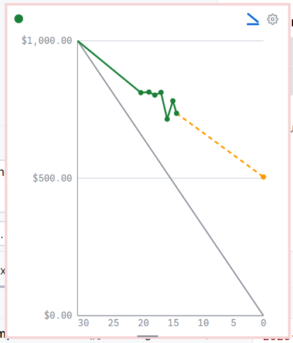
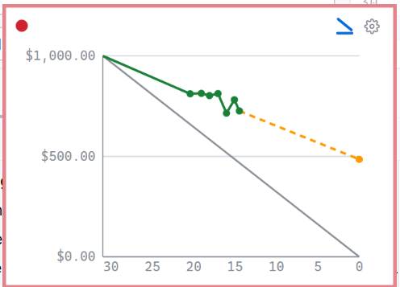
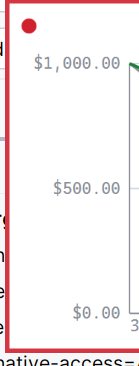

show claude code version

add ping functionality

add show the token

create token.

send a prompt

create a view burndown. it shows a kind of burndown chart, on x axis the 
number of days of the current month in a decreasing way. y-axis is the credit 
left for the month. there should be a line drawn from the top left to button right.
based on the history data, the left credit on each day is a data point
in the chart. the data points are connected by lines. if there is value for a
day not available connect the points left and right the missing value of that
day. based on the data points extrapolate the data till the end of the month
and draw a line of with a different color till the end of the month. label the
x - axis in 5 days step. add an icon for the main row to oprn burndown view.

 on an own row, version v0.96

 burndown chart should also be horizontal resizeable

 When the usage in the burndown chart is over the
credit, the line should use red color, otherwise green.

 the dollar values take too much space. perhaps writing it
as $1k, and or make the dollar symbol configurable, default turned off.

